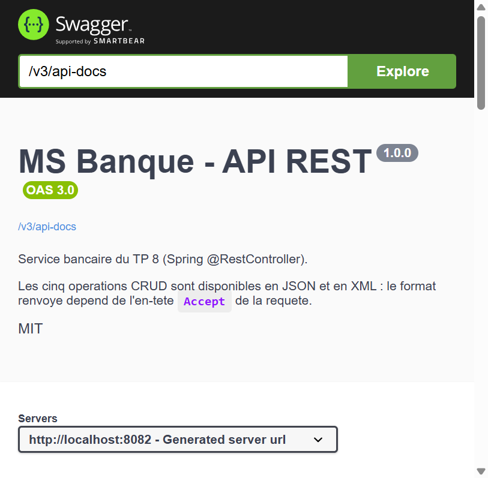
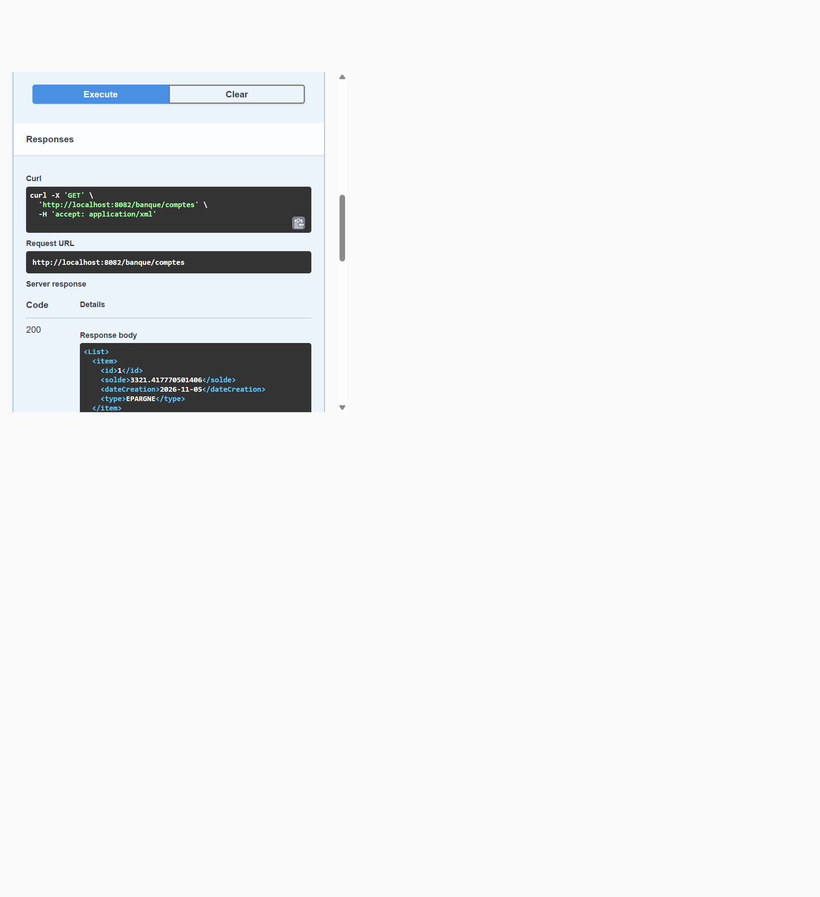

# TP 8 — Spring `@RestController` (Cours 7 : Architecture Microservices)

Projet **Spring Boot 3.3.5** répondant au TP 8 du cours 7
(« Architecture Microservices : Conception, Déploiement et Orchestration ») :
un **service REST bancaire** exposé par un simple **`@RestController` Spring MVC**,
qui répond **en JSON et en XML** sur la même URL, documenté automatiquement par
**Swagger / OpenAPI** (springdoc), avec persistance JPA dans une base **H2 en
mémoire**.

C'est la variante « Spring pur » du TP 7 : au lieu d'une ressource JAX-RS gérée
par Jersey, on utilise un contrôleur Spring MVC annoté `@RestController`, et
c'est `MappingJackson2XmlHttpMessageConverter` (et non JAXB) qui produit le XML.

| Élément | Valeur |
|---|---|
| Projet Maven | `ma.rest:ms-banque:1.0.0` |
| Spring Boot | 3.3.5 (parent) |
| Java | 17 |
| Package de base | `ma.rest.spring` (comme dans l'énoncé) |
| API REST | Spring MVC — `@RestController` |
| Documentation | springdoc-openapi **2.6.0** (Swagger UI) |
| Base de données | H2 en mémoire (`jdbc:h2:mem:banque`) |
| Tests | **19 tests JUnit 5 — 19 ✅** (6 repository + 13 API) |
| Port | `8082` |

* Ressource REST : <http://localhost:8082/banque/comptes>
* Swagger UI : <http://localhost:8082/swagger-ui.html>
* Document OpenAPI brut : <http://localhost:8082/v3/api-docs>
* Console H2 : <http://localhost:8082/h2-console>

---

## Sommaire

1. [Environnement et prérequis](#1-environnement-et-prérequis)
2. [Architecture du projet](#2-architecture-du-projet)
3. [Les 12 étapes du TP](#3-les-12-étapes-du-tp)
4. [Dépendances du `pom.xml`](#4-dépendances-du-pomxml)
5. [Les endpoints REST](#5-les-endpoints-rest)
6. [JSON et XML sur la même URL](#6-json-et-xml-sur-la-même-url)
7. [Swagger / OpenAPI](#7-swagger--openapi)
8. [Tests automatisés (19 tests)](#8-tests-automatisés-19-tests)
9. [Résultats d'exécution réels](#9-résultats-dexécution-réels)
10. [Choix techniques et points d'attention](#10-choix-techniques-et-points-dattention)

---

## 1. Environnement et prérequis

| Élément | Version utilisée |
|---|---|
| JDK | 17 (`java.version = 17`) |
| Maven | Apache Maven 3.9+ |
| Spring Boot | 3.3.5 |
| Spring MVC | 6.1.x (tiré par le parent) |
| springdoc-openapi | 2.6.0 |
| `jackson-dataformat-xml` | 2.17.x (tiré par le parent) |
| Base de données | H2 2.2.224 en mémoire |
| Tests | JUnit 5, AssertJ, `TestRestTemplate` |

Aucune base externe n'est nécessaire : H2 est **en mémoire** et recréée à chaque
démarrage, ce qui rend le projet totalement autonome.

### Commandes

```bash
# Compilation
mvn clean compile

# Tests (les 19 tests, dont 13 qui passent réellement par le serveur HTTP)
mvn clean test

# Packaging (jar exécutable)
mvn clean package

# Exécution
java -jar target/ms-banque-1.0.0.jar
# ou
mvn spring-boot:run
```

Puis ouvrir <http://localhost:8082/banque/comptes> ou
<http://localhost:8082/swagger-ui.html>.

> ⚠️ Si un jar de l'application tourne encore, `mvn clean` échoue sur Windows
> parce que le fichier `target/ms-banque-1.0.0.jar` est verrouillé. Arrêter le
> processus avant de relancer le build.

---

## 2. Architecture du projet

```
lab8Microservice/
├── pom.xml
├── README.md
├── docs/                                          # preuves d'exécution
│   ├── build-tests.log                            # mvn clean test : 19/19
│   ├── startup.log                                # démarrage + DDL Hibernate
│   ├── endpoints-demo.log                         # 17 scénarios en HTTP réel
│   └── images/
│       ├── swagger-ui.png                         # Swagger UI au démarrage
│       └── swagger-ui-response.png                # « Try it out » exécuté
├── tools/
│   └── demo-endpoints.bat                         # script curl reproductible
└── src/
    ├── main/
    │   ├── java/ma/rest/spring/
    │   │   ├── MsBanqueApplication.java            # @SpringBootApplication + CommandLineRunner
    │   │   ├── entities/
    │   │   │   ├── Compte.java                     # @Entity + @JacksonXmlRootElement
    │   │   │   └── TypeCompte.java                 # enum COURANT / EPARGNE
    │   │   ├── repositories/CompteRepository.java  # Spring Data JPA
    │   │   ├── config/OpenApiConfig.java           # métadonnées OpenAPI
    │   │   └── web/
    │   │       ├── CompteController.java           # 5 endpoints @RestController
    │   │       └── GlobalExceptionHandler.java     # 400 en ProblemDetail
    │   └── resources/application.properties
    └── test/java/ma/rest/spring/
        ├── repositories/CompteRepositoryTest.java  # 6 tests @DataJpaTest
        └── web/CompteControllerTest.java           # 13 tests HTTP
```

Le chemin d'une requête est direct, sans couche service (l'énoncé ne la demande pas) :

```
HTTP  →  DispatcherServlet  →  CompteController  →  CompteRepository  →  H2 (table compte)
         HandlerMapping        @GetMapping/…        JpaRepository        jdbc:h2:mem:banque
         négociation JSON/XML  produces/consumes
         (Jackson JSON + XML)
```

---

## 3. Les 12 étapes du TP

| Étape de l'énoncé | Demande | Implémentation |
|---|---|---|
| 1 | Créer le projet avec Spring Initializr | [`pom.xml`](./pom.xml) : parent `spring-boot-starter-parent` 3.3.5 + starters **Web**, **Data JPA**, **H2**, **Lombok**, **DevTools** |
| 2 | Configurer la base H2 | [`application.properties`](./src/main/resources/application.properties) : `jdbc:h2:mem:banque`, `server.port=8082`, console `/h2-console` |
| 3 | Entité JPA `Compte` | [`Compte`](./src/main/java/ma/rest/spring/entities/Compte.java) : `@Entity`, `Long id`, `double solde`, `Date dateCreation`, `TypeCompte type` |
| 4 | Énumération `TypeCompte` | [`TypeCompte`](./src/main/java/ma/rest/spring/entities/TypeCompte.java) : `COURANT`, `EPARGNE` |
| 5 | Dépôt JPA | [`CompteRepository`](./src/main/java/ma/rest/spring/repositories/CompteRepository.java) : `extends JpaRepository<Compte, Long>` |
| 6 | Initialiser les données | `@Bean CommandLineRunner start(...)` dans [`MsBanqueApplication`](./src/main/java/ma/rest/spring/MsBanqueApplication.java) : 3 comptes aléatoires |
| 7 | Contrôleur `@RestController` | [`CompteController`](./src/main/java/ma/rest/spring/web/CompteController.java) : `@RestController` + `@RequestMapping("/banque")` + 5 méthodes CRUD |
| 8 | Documenter avec Swagger | dépendance `springdoc-openapi-starter-webmvc-ui` + [`OpenApiConfig`](./src/main/java/ma/rest/spring/config/OpenApiConfig.java) + annotations `@Tag` / `@Operation` / `@ApiResponse` |
| 9 | Support JSON **et** XML | dépendance `jackson-dataformat-xml` + `produces` / `consumes` avec `application/json` **et** `application/xml` + `@JacksonXmlRootElement` |
| 10 | Lancer l'application | `mvn spring-boot:run` ou `java -jar target/ms-banque-1.0.0.jar` → Tomcat sur le port 8082 |
| 11 | Tester avec Postman / curl / SoapUI | [`tools/demo-endpoints.bat`](./tools/demo-endpoints.bat) → [`docs/endpoints-demo.log`](./docs/endpoints-demo.log) (17 scénarios) |
| 12 | À retenir | voir [§ 10](#10-choix-techniques-et-points-dattention) |

### Étape 2 — la base H2

```properties
server.port=8082

spring.datasource.url=jdbc:h2:mem:banque;DB_CLOSE_DELAY=-1;DB_CLOSE_ON_EXIT=FALSE
spring.datasource.driver-class-name=org.h2.Driver
spring.datasource.username=sa
spring.datasource.password=

spring.h2.console.enabled=true
spring.h2.console.path=/h2-console

spring.jpa.show-sql=true
spring.jpa.properties.hibernate.format_sql=true
spring.jpa.hibernate.ddl-auto=update
spring.jpa.open-in-view=false
```

`DB_CLOSE_DELAY=-1` garde la base vivante tant que la JVM tourne, même si toutes
les connexions sont fermées ; c'est ce qui permet à la console H2 de voir les
données créées par l'application.

### Étapes 3 et 4 — l'entité et l'énumération

```java
public enum TypeCompte {
    COURANT, EPARGNE
}
```

```java
@Entity
@Table(name = "compte")
@Data
@NoArgsConstructor
@AllArgsConstructor
@JacksonXmlRootElement(localName = "compte")
public class Compte {

    @Id
    @GeneratedValue(strategy = GenerationType.IDENTITY)
    private Long id;

    private double solde;

    @Temporal(TemporalType.DATE)
    @JsonFormat(pattern = "yyyy-MM-dd", timezone = "Europe/Paris")
    private Date dateCreation;

    @Enumerated(EnumType.STRING)
    private TypeCompte type;
}
```

Trois points importants :

* `javax.persistence` de l'énoncé devient **`jakarta.persistence`** : Spring Boot 3
  s'appuie sur Jakarta EE 9+.
* `@Enumerated(EnumType.STRING)` stocke le **libellé** (`COURANT`, `EPARGNE`) et
  non l'index : la colonne est lisible en base et résiste à un réordonnancement
  de l'énumération. C'est explicitement demandé ici (le TP 7 utilisait ORDINAL).
* `@JacksonXmlRootElement(localName = "compte")` fixe le nom de l'élément racine
  XML et rend le contrat explicite.

### Étape 5 — le dépôt JPA

```java
@Repository
public interface CompteRepository extends JpaRepository<Compte, Long> {
}
```

### Étape 6 — l'initialisation des données

```java
@Bean
CommandLineRunner start(CompteRepository compteRepository) {
    return args -> {
        compteRepository.save(new Compte(null, Math.random() * 9000, new Date(), TypeCompte.EPARGNE));
        compteRepository.save(new Compte(null, Math.random() * 9000, new Date(), TypeCompte.COURANT));
        compteRepository.save(new Compte(null, Math.random() * 9000, new Date(), TypeCompte.EPARGNE));

        compteRepository.findAll().forEach(c -> System.out.println(c.toString()));
    };
}
```

### Étape 7 — le contrôleur `@RestController`

```java
@RestController
@RequestMapping("/banque")
@Tag(name = "Comptes", description = "Gestion des comptes bancaires (JSON et XML)")
public class CompteController {

    private final CompteRepository compteRepository;

    public CompteController(CompteRepository compteRepository) {
        this.compteRepository = compteRepository;
    }

    @GetMapping(value = "/comptes", produces = {"application/json", "application/xml"})
    public List<Compte> getAllComptes() {
        return compteRepository.findAll();
    }

    @GetMapping(value = "/comptes/{id}", produces = {"application/json", "application/xml"})
    public ResponseEntity<Compte> getCompteById(@PathVariable Long id) {
        return compteRepository.findById(id)
                .map(compte -> ResponseEntity.ok().body(compte))
                .orElse(ResponseEntity.notFound().build());
    }

    @PostMapping(value = "/comptes",
            consumes = {"application/json", "application/xml"},
            produces = {"application/json", "application/xml"})
    public ResponseEntity<Compte> createCompte(@RequestBody Compte compte) {
        Compte savedCompte = compteRepository.save(compte);
        URI location = ServletUriComponentsBuilder.fromCurrentRequest()
                .path("/{id}")
                .buildAndExpand(savedCompte.getId())
                .toUri();
        return ResponseEntity.created(location).body(savedCompte);
    }

    @PutMapping(value = "/comptes/{id}",
            consumes = {"application/json", "application/xml"},
            produces = {"application/json", "application/xml"})
    public ResponseEntity<Compte> updateCompte(@PathVariable Long id, @RequestBody Compte compteDetails) {
        return compteRepository.findById(id)
                .map(compte -> {
                    compte.setSolde(compteDetails.getSolde());
                    compte.setDateCreation(compteDetails.getDateCreation());
                    compte.setType(compteDetails.getType());
                    return ResponseEntity.ok().body(compteRepository.save(compte));
                }).orElse(ResponseEntity.notFound().build());
    }

    @DeleteMapping("/comptes/{id}")
    public ResponseEntity<Void> deleteCompte(@PathVariable Long id) {
        return compteRepository.findById(id)
                .map(compte -> {
                    compteRepository.delete(compte);
                    return ResponseEntity.ok().<Void>build();
                }).orElse(ResponseEntity.notFound().build());
    }
}
```

### Étape 8 — Swagger / OpenAPI

La dépendance suffit à exposer le document et l'interface :

```xml
<dependency>
    <groupId>org.springdoc</groupId>
    <artifactId>springdoc-openapi-starter-webmvc-ui</artifactId>
    <version>${springdoc.version}</version>   <!-- 2.6.0 -->
</dependency>
```

```properties
springdoc.api-docs.path=/v3/api-docs
springdoc.swagger-ui.path=/swagger-ui.html
springdoc.swagger-ui.operations-sorter=method
springdoc.swagger-ui.tags-sorter=alpha
springdoc.swagger-ui.display-request-duration=true
```

Puis les métadonnées sont personnalisées dans un bean `OpenAPI` (sinon Swagger UI
affiche « OpenAPI definition ») — voir [§ 7](#7-swagger--openapi).

### Étape 9 — le support XML

```xml
<dependency>
    <groupId>com.fasterxml.jackson.dataformat</groupId>
    <artifactId>jackson-dataformat-xml</artifactId>
</dependency>
```

Cette seule dépendance enregistre `MappingJackson2XmlHttpMessageConverter` :
Spring peut alors sérialiser les mêmes objets Java en XML, et la sélection se
fait par l'en-tête `Accept`. Aucune classe `XmlAdapter` n'est nécessaire ici,
contrairement au TP 7 : `@JsonFormat(pattern = "yyyy-MM-dd")` s'applique aussi
au XML produit par Jackson.

### Étape 10 — le lancement

```
Tomcat initialized with port 8082 (http)
Tomcat started on port 8082 (http) with context path '/'
Started MsBanqueApplication in 7.019 seconds
```

### Étape 11 — les tests client

Postman, curl ou SoapUI appellent tous la même URL. Le script
[`tools/demo-endpoints.bat`](./tools/demo-endpoints.bat) reproduit les 17
scénarios en `curl.exe` et écrit la sortie dans
[`docs/endpoints-demo.log`](./docs/endpoints-demo.log).

---

## 4. Dépendances du `pom.xml`

| Dépendance | Rôle |
|---|---|
| `spring-boot-starter-web` | Spring MVC, `@RestController`, Tomcat embarqué, Jackson JSON |
| `spring-boot-starter-data-jpa` | Hibernate / Spring Data : persistance de `Compte` |
| `com.h2database:h2` | base en mémoire `jdbc:h2:mem:banque` |
| `springdoc-openapi-starter-webmvc-ui` 2.6.0 | document OpenAPI `/v3/api-docs` + interface Swagger UI |
| `com.fasterxml.jackson.dataformat:jackson-dataformat-xml` | sérialisation / désérialisation XML |
| `org.projectlombok:lombok` | `@Data`, `@NoArgsConstructor`, `@AllArgsConstructor` |
| `spring-boot-devtools` | redémarrage automatique en développement |
| `spring-boot-starter-test` | JUnit 5, AssertJ, `TestRestTemplate` |

Artefacts réellement résolus (extrait de `mvn dependency:tree`) :

```
org.springframework.boot:spring-boot-starter-web:3.3.5
 +- org.springframework.boot:spring-boot-starter-json:3.3.5
 |   \- com.fasterxml.jackson.datatype:jackson-datatype-jsr310:2.17.x
 +- org.springframework:spring-webmvc:6.1.x
 \- org.springframework.boot:spring-boot-starter-tomcat:3.3.5

com.fasterxml.jackson.dataformat:jackson-dataformat-xml:2.17.x
 \- org.codehaus.woodstox:stax2-api:4.2.2

org.springdoc:springdoc-openapi-starter-webmvc-ui:2.6.0
 +- org.springdoc:springdoc-openapi-starter-webmvc-api:2.6.0
 \- org.webjars:swagger-ui:5.17.14
```

`lombok` et `devtools` sont exclus du jar par `spring-boot-maven-plugin`
(ils ne servent qu'à la compilation et au développement).

---

## 5. Les endpoints REST

Toutes les URL commencent par `/banque` (le `@RequestMapping` de la classe).

| Méthode | URL | `Consumes` | `Produces` | Succès | Erreur |
|---|---|---|---|---|---|
| `GET` | `/banque/comptes` | — | JSON, XML | **200** liste des comptes | **406** si `Accept` non supporté |
| `GET` | `/banque/comptes/{id}` | — | JSON, XML | **200** le compte | **404** si l'id est inconnu, **400** si l'id n'est pas numérique |
| `POST` | `/banque/comptes` | JSON, XML | JSON, XML | **201** + en-tête `Location` | **400** corps illisible, **415** `Content-Type` non supporté |
| `PUT` | `/banque/comptes/{id}` | JSON, XML | JSON, XML | **200** le compte modifié | **404** si l'id est inconnu, **400** corps illisible |
| `DELETE` | `/banque/comptes/{id}` | — | — | **200** sans corps | **404** si l'id est inconnu |

Deux choix à noter :

* **`DELETE` répond 200, pas 204.** L'énoncé demande explicitement
  `ResponseEntity.ok()` ; c'est aussi ce que montre son exemple Postman. Le corps
  est vide, seul le code diffère du 204 plus « orthodoxe ».
* **`GET /{id}` renvoie 404 sans corps** (`ResponseEntity.notFound().build()`),
  conformément à l'énoncé. Les erreurs de *format* sont, elles, centralisées dans
  [`GlobalExceptionHandler`](./src/main/java/ma/rest/spring/web/GlobalExceptionHandler.java)
  qui produit un `ProblemDetail` (`application/problem+json`) :

```json
{
  "type": "about:blank",
  "title": "Requete invalide",
  "status": 400,
  "detail": "Corps de requete illisible : verifiez la syntaxe JSON/XML et les valeurs des champs.",
  "instance": "/banque/comptes"
}
```

---

## 6. JSON et XML sur la même URL

C'est le cœur de l'étape 9 : **une seule méthode Java** produit deux formats.
Spring choisit d'après l'en-tête **`Accept`** du client (négociation de contenu)
et lit le corps d'après **`Content-Type`**. Sans `Accept`, le JSON est renvoyé par
défaut (premier type listé dans `produces`).

### `GET /banque/comptes` avec `Accept: application/json`

```
HTTP/1.1 200
Content-Type: application/json

[{"id":1,"solde":3321.417770501406,"dateCreation":"2026-11-05","type":"EPARGNE"},
 {"id":2,"solde":6464.624377122525,"dateCreation":"2026-11-05","type":"COURANT"},
 {"id":3,"solde":8459.708578450454,"dateCreation":"2026-11-05","type":"EPARGNE"}]
```

### `GET /banque/comptes` avec `Accept: application/xml`

```
HTTP/1.1 200
Content-Type: application/xml

<List><item><id>1</id><solde>3321.417770501406</solde><dateCreation>2026-11-05</dateCreation><type>EPARGNE</type></item><item><id>2</id><solde>6464.624377122525</solde><dateCreation>2026-11-05</dateCreation><type>COURANT</type></item><item><id>3</id><solde>8459.708578450454</solde><dateCreation>2026-11-05</dateCreation><type>EPARGNE</type></item></List>
```

> **Pourquoi `<List><item>` et non `<comptes><compte>` ?**
> C'est une différence de fond avec JAXB (TP 7). Jackson-XML nomme l'élément
> racine d'une collection d'après le **type déclaré** de la valeur de retour
> (`java.util.List`) et chaque élément `item`. Le `@JacksonXmlRootElement` de
> `Compte` n'intervient que pour un objet **seul** — voir le `GET /{id}`
> ci-dessous, qui donne bien `<compte>`. Pour obtenir `<comptes><compte>`, il
> faudrait changer la signature de la méthode (renvoyer un wrapper annoté), ce
> qui modifierait aussi la forme du JSON. Le code de l'énoncé produit donc bien
> `<List><item>`, et les tests ainsi que la capture Swagger le documentent tel
> quel.

### `GET /banque/comptes/1` avec `Accept: application/xml`

```
HTTP/1.1 200
Content-Type: application/xml

<compte><id>1</id><solde>3321.417770501406</solde><dateCreation>2026-11-05</dateCreation><type>EPARGNE</type></compte>
```

L'élément racine est bien `compte`, grâce à `@JacksonXmlRootElement`.

### Envoi d'un `POST` en JSON

```bash
curl -X POST http://localhost:8082/banque/comptes \
  -H "Content-Type: application/json" -H "Accept: application/json" \
  -d '{"solde": 1500.0, "dateCreation": "2024-11-01", "type": "COURANT"}'
```

```
HTTP/1.1 201
Location: http://localhost:8082/banque/comptes/4
Content-Type: application/json

{"id":4,"solde":1500.0,"dateCreation":"2024-11-01","type":"COURANT"}
```

### Envoi du même `POST` en XML

```bash
curl -X POST http://localhost:8082/banque/comptes \
  -H "Content-Type: application/xml" -H "Accept: application/xml" \
  -d '<compte><solde>1500.0</solde><dateCreation>2024-11-01</dateCreation><type>COURANT</type></compte>'
```

```
HTTP/1.1 201
Location: http://localhost:8082/banque/comptes/5
Content-Type: application/xml

<compte><id>5</id><solde>1500.0</solde><dateCreation>2024-11-01</dateCreation><type>COURANT</type></compte>
```

Le corps de la réponse respecte `Accept` : Spring réutilise le même convertisseur
pour la sortie. `Location` est construit par `ServletUriComponentsBuilder`, donc
il contient l'hôte et le port réellement utilisés.

### `Accept` non supporté

```
HTTP/1.1 406
Accept: application/json, application/xml
```

Spring indique dans l'en-tête `Accept` de la **réponse** les types réellement
disponibles, ce qui rend le diagnostic immédiat côté client.

---

## 7. Swagger / OpenAPI

### Métadonnées personnalisées

```java
@Configuration
public class OpenApiConfig {

    @Bean
    public OpenAPI banqueOpenAPI() {
        return new OpenAPI()
                .info(new Info()
                        .title("MS Banque - API REST")
                        .version("1.0.0")
                        .description("""
                                Service bancaire du TP 8 (Spring @RestController).

                                Les cinq operations CRUD sont disponibles en JSON et en XML :
                                le format renvoye depend de l'en-tete `Accept` de la requete.
                                """)
                        .contact(new Contact().name("Yasmine Ait Halibi"))
                        .license(new License().name("MIT")));
    }
}
```

### Annotations sur le contrôleur

`@Tag` sur la classe, `@Operation` sur chaque méthode, et `@ApiResponse` pour
documenter les codes autres que 200 :

```java
@Operation(summary = "Consulter un compte par son identifiant")
@ApiResponse(responseCode = "200", description = "Compte trouve")
@ApiResponse(responseCode = "404", description = "Aucun compte pour cet identifiant")
@GetMapping(value = "/comptes/{id}", produces = {"application/json", "application/xml"})
```

### Le document généré

`GET /v3/api-docs` renvoie (extrait) :

```json
{
  "openapi": "3.0.1",
  "info": {
    "title": "MS Banque - API REST",
    "description": "Service bancaire du TP 8 (Spring @RestController).…",
    "contact": { "name": "Yasmine Ait Halibi" },
    "license": { "name": "MIT" },
    "version": "1.0.0"
  },
  "servers": [{ "url": "http://localhost:8082", "description": "Generated server url" }],
  "tags": [{ "name": "Comptes", "description": "Gestion des comptes bancaires (JSON et XML)" }],
  "paths": {
    "/banque/comptes": { "get": { "operationId": "getAllComptes", … }, "post": { … } },
    "/banque/comptes/{id}": { "get": { … }, "put": { … }, "delete": { … } }
  },
  "components": {
    "schemas": {
      "Compte": {
        "type": "object",
        "properties": {
          "id":           { "type": "integer", "format": "int64" },
          "solde":        { "type": "number",  "format": "double" },
          "dateCreation": { "type": "string",  "format": "date-time" },
          "type":         { "type": "string",  "enum": ["COURANT", "EPARGNE"] }
        }
      }
    }
  }
}
```

Chaque opération liste **les deux** types de média (`application/json` et
`application/xml`), ce qui reflète exactement les `produces` / `consumes` du
contrôleur.

### L'interface

* `GET /swagger-ui.html` → **302** vers `/swagger-ui/index.html` → **200**.





La seconde capture montre une exécution réelle depuis le navigateur : la réponse
`200` renvoyée par le serveur est bien le XML `<List><item>…</item></List>`, avec
`content-type: application/xml` et `request duration: 115 ms`.

---

## 8. Tests automatisés (19 tests)

| Fichier | Nb | Type | Ce qui est vérifié |
|---|---|---|---|
| [`CompteRepositoryTest`](./src/test/java/ma/rest/spring/repositories/CompteRepositoryTest.java) | 6 | `@DataJpaTest` (H2) | `save` génère l'id, `findAll`, `findById`, `findById` inconnu → vide, `deleteById`, type stocké **en chaîne** |
| [`CompteControllerTest`](./src/test/java/ma/rest/spring/web/CompteControllerTest.java) | 13 | `@SpringBootTest(RANDOM_PORT)` + `TestRestTemplate` | les 5 endpoints en **HTTP réel**, JSON **et** XML, plus les cas d'erreur |

### Les 6 tests du dépôt

| Test | Attend |
|---|---|
| `saveGeneratesId` | l'id est `null` avant `save`, non `null` après |
| `findAllReturnsEveryAccount` | 2 comptes insérés → `findAll()` en renvoie 2 |
| `findByIdReturnsAccount` | le compte retrouvé a le bon solde et le bon type |
| `findByIdUnknownReturnsEmpty` | `Optional.empty()` |
| `deleteByIdRemovesAccount` | `count()` passe à 0 |
| `enumerationIsStoredAsString` | une requête native sur la colonne `type` renvoie `'EPARGNE'`, pas `1` |

### Les 13 tests HTTP

| Test | Attend |
|---|---|
| `getAllComptesAsJson` | 200 + `Content-Type: application/json` + 2 éléments |
| `getAllComptesAsXml` | 200 + `Content-Type: application/xml` + `<List>` et `<item>` |
| `getCompteByIdAsJson` | 200 + solde et type conformes |
| `getCompteByIdUnknownReturnsNotFound` | 404 |
| `createCompteAsJson` | 201 + en-tête `Location` + corps avec un id |
| `createCompteAsXml` | 201 + `Location` + corps XML contenant `<compte>` |
| `updateCompteAsJson` | 200 + solde et type mis à jour |
| `updateCompteUnknownReturnsNotFound` | 404 |
| `deleteCompteThenNotFound` | 200 à la suppression, puis 404 sur le même id |
| `createWithMalformedJsonReturnsBadRequest` | 400 + `title: Requete invalide` |
| `getWithNonNumericIdReturnsBadRequest` | 400 + `detail` contenant `abc` |
| `defaultContentTypeIsJson` | sans `Accept`, la réponse est en JSON |
| `unsupportedAcceptReturnsNotAcceptable` | `Accept: text/html` → 406 |

Les tests de la couche web vident la table avant chaque méthode
(`DELETE FROM compte` puis `deleteAll()`), pour ne pas dépendre de l'ordre
d'exécution ni des 3 comptes créés par le `CommandLineRunner`.

```
[INFO] Tests run: 6,  Failures: 0, Errors: 0, Skipped: 0 -- CompteRepositoryTest
[INFO] Tests run: 13, Failures: 0, Errors: 0, Skipped: 0 -- CompteControllerTest
[INFO] Tests run: 19, Failures: 0, Errors: 0, Skipped: 0
[INFO] BUILD SUCCESS
```

Sortie complète : [`docs/build-tests.log`](./docs/build-tests.log).

---

## 9. Résultats d'exécution réels

### Démarrage ([`docs/startup.log`](./docs/startup.log))

```
  .   ____          _            __ _ _
 /\\ / ___'_ __ _ _(_)_ __  __ _ \ \ \ \
( ( )\___ | '_ | '_| | '_ \/ _` | \ \ \ \
 \\/  ___)| |_)| | | | | || (_| |  ) ) ) )
  '  |____| .__|_| |_|_| |_\__, | / / / /
 =========|_|==============|___/=/_/_/_/

 :: Spring Boot ::                (v3.3.5)

Tomcat initialized with port 8082 (http)
Starting Servlet engine: [Apache Tomcat/10.1.31]
HikariPool-1 - Added connection conn0: url=jdbc:h2:mem:banque user=SA
H2 console available at '/h2-console'. Database available at 'jdbc:h2:mem:banque'

Hibernate:
    create table compte (
        id bigint generated by default as identity,
        date_creation date,
        solde float(53) not null,
        type enum ('COURANT','EPARGNE'),
        primary key (id)
    )

Tomcat started on port 8082 (http) with context path '/'
Started MsBanqueApplication in 7.019 seconds

Compte(id=1, solde=6710.777579102125, dateCreation=2026-11-05, type=EPARGNE)
Compte(id=2, solde=7474.814310624942, dateCreation=2026-11-05, type=COURANT)
Compte(id=3, solde=1234.498081231298, dateCreation=2026-11-05, type=EPARGNE)
```

La colonne `type enum ('COURANT','EPARGNE')` prouve que
`@Enumerated(EnumType.STRING)` est bien pris en compte par Hibernate 6.

### Scénario complet ([`docs/endpoints-demo.log`](./docs/endpoints-demo.log))

```
GET    /banque/comptes        Accept: application/json   --> 200  [3 comptes]
GET    /banque/comptes        Accept: application/xml    --> 200  <List><item>…
GET    /banque/comptes/1      Accept: application/json   --> 200  {"id":1,…}
GET    /banque/comptes/1      Accept: application/xml    --> 200  <compte>…
GET    /banque/comptes/9999                             --> 404

POST   /banque/comptes        Content-Type: application/json  --> 201  Location: …/comptes/4
POST   /banque/comptes        Content-Type: application/xml   --> 201  Location: …/comptes/5
PUT    /banque/comptes/4      Content-Type: application/json  --> 200  {"id":4,"solde":2000.0,…}
PUT    /banque/comptes/5      Content-Type: application/xml   --> 200  <compte>…<solde>2000.0</solde>…
PUT    /banque/comptes/9999                                 --> 404
DELETE /banque/comptes/4                                    --> 200
DELETE /banque/comptes/4                                    --> 404
POST   /banque/comptes        corps JSON invalide            --> 400  ProblemDetail
GET    /banque/comptes/abc                                  --> 400  ProblemDetail
GET    /banque/comptes        Accept: text/html             --> 406  (Accept: application/json, application/xml)

GET    /v3/api-docs                                         --> 200  document OpenAPI
GET    /swagger-ui.html                                     --> 302  → /swagger-ui/index.html (200)
GET    /h2-console                                          --> 302  → /h2-console/
```

### Corps d'erreur réels

```json
{"type":"about:blank","title":"Requete invalide","status":400,
 "detail":"Corps de requete illisible : verifiez la syntaxe JSON/XML et les valeurs des champs.",
 "instance":"/banque/comptes"}

{"type":"about:blank","title":"Parametre invalide","status":400,
 "detail":"Parametre 'id' invalide : abc",
 "instance":"/banque/comptes/abc"}
```

### Console H2

`GET /h2-console` répond **302** vers `/h2-console/` : la console est bien
enregistrée. La connexion se fait avec `jdbc:h2:mem:banque`, utilisateur `sa`,
mot de passe vide.

---

## 10. Choix techniques et points d'attention

* **springdoc 2.6.0 et non 2.1.0** — l'énoncé cite
  `springdoc-openapi-starter-webmvc-ui` en **2.1.0**. Cette version est
  incompatible avec Spring Boot 3.3.x (signature de `ControllerAdviceBean`
  modifiée dans Spring Framework 6.1) : l'application ne démarre pas. La branche
  **2.6.x**, prévue pour Boot 3.3, est utilisée à la place ; le numéro de version
  est isolé dans la propriété `springdoc.version` du `pom.xml`, avec un
  commentaire qui explique l'écart.
* **`javax` → `jakarta`** — toutes les annotations JPA de l'énoncé
  (`javax.persistence.*`) deviennent `jakarta.persistence.*`. Spring Boot 3 ne
  supporte plus l'ancien namespace.
* **`@Enumerated(STRING)` ici, `ORDINAL` au TP 7** — l'énoncé du TP 8 demande
  explicitement `STRING`. Le DDL le confirme (`type enum ('COURANT','EPARGNE')`)
  et un test le vérifie par requête native. Les libellés survivent à un
  réordonnancement de l'énumération, contrairement aux index.
* **`<List><item>` en XML pour une collection** — Jackson-XML se base sur le type
  déclaré de la valeur de retour. Pour un objet seul, `@JacksonXmlRootElement`
  donne `<compte>`. Trois contournements ont été essayés et écartés : un wrapper
  annoté change la forme du JSON (`{"comptes":[…]}`), `@JsonValue` casse le nom
  des éléments, `@JsonFormat(shape = ARRAY)` produit un `<compte>` par **champ**.
  Le comportement de l'énoncé est donc conservé et documenté.
* **Pas d'`XmlAdapter`** — contrairement au TP 7, `@JsonFormat(pattern =
  "yyyy-MM-dd")` s'applique aussi à la sérialisation XML de Jackson : la date
  reste `2024-11-01` dans les deux formats, sans code supplémentaire.
* **`DELETE` → 200** — `ResponseEntity.ok()` conformément à l'énoncé, même si
  `204 No Content` serait plus habituel pour une suppression sans corps.
* **`open-in-view=false`** — évite le warning de Spring Boot et garantit que
  toutes les données sont chargées avant la sérialisation, ce qui rend les tests
  déterministes.
* **`GlobalExceptionHandler` limité aux erreurs de format** — seules
  `HttpMessageNotReadableException` (corps illisible) et
  `MethodArgumentTypeMismatchException` (`/abc`) sont interceptées. Le reste garde
  le comportement par défaut de Spring Boot, y compris la page d'erreur 406.
* **Pas de couche `service`** — l'énoncé fait appeler `CompteRepository`
  directement depuis le contrôleur ; le projet suit cette consigne plutôt que
  d'ajouter une abstraction non demandée.
* **DevTools exclu du jar** — `<exclude>` dans `spring-boot-maven-plugin` pour
  éviter les redémarrages automatiques en production.
* **`CorsConfig` ajouté pour le TP 9** — le client React (`lab9Microservice`,
  port 3000) appelle cette API depuis le navigateur ; sans en-têtes CORS le
  preflight `OPTIONS` du `POST` JSON est bloqué et la liste ne se charge pas. La
  classe `ma.rest.spring.config.CorsConfig` autorise explicitement
  `http://localhost:3000` et `http://127.0.0.1:3000` sur `/banque/**` plutôt que
  `"*"`, avec un cache de preflight d'une heure. Trois tests MockMvc la
  vérifient. Ce n'est pas une fonctionnalité du TP 8 : elle n'existe que pour
  rendre le TP 9 utilisable, un proxy CRA ne fonctionnant qu'en développement.
* **`mvn clean` et jar en cours d'exécution** — sur Windows, le jar packagé est
  verrouillé tant que le processus Java tourne ; il faut l'arrêter avant de
  relancer un build propre. De la même manière, ne pas rediriger la sortie du
  programme vers un fichier situé dans `target/`, sinon le répertoire ne peut plus
  être supprimé.
